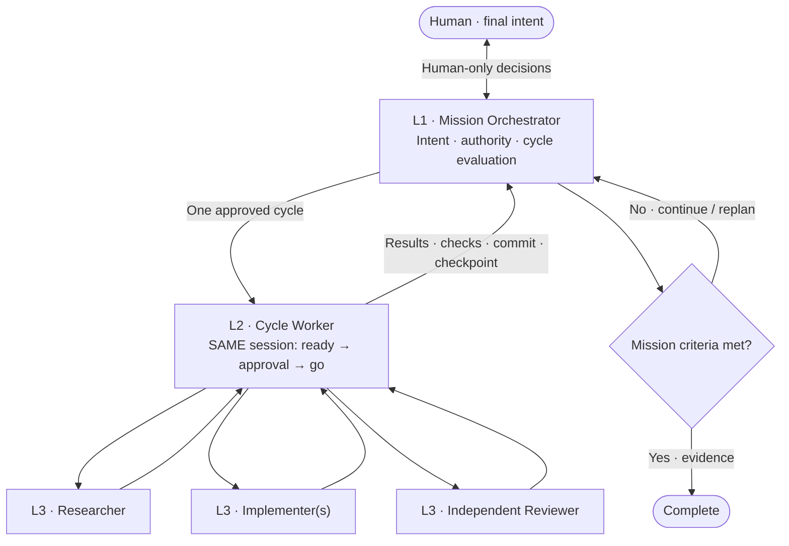

<div align="center">

# ⟲ Ouroboros

### Keep the intent. Close the loop.

**An intent-driven, three-level development harness.**  
From a human goal to a verified result — one `ready → go` cycle at a time.

[](#the-cycle)
[](#architecture)
[](#implementation-status)
[](LICENSE)

[**Get started**](#try-it) · [**Architecture**](#architecture) · [**Mission guide**](docs/MISSION.md) · [**한국어**](README_ko.md)

</div>

---

> [!IMPORTANT]
> **Cycle success is not mission success.** Ouroboros keeps the human's approved intent at the top and uses observed evidence — not an agent's confidence — to choose what comes next.

> [!WARNING]
> **Experimental, not a turnkey autonomous service.** The repository includes skills, lifecycle contracts, and a tested local mission ledger. An optional [local runtime bridge](docs/RUNTIME.md) connects real Claude SDK sessions and Codex App Server threads. It does **not** auto-install dependencies/global hooks or establish live three-level acceptance. The host must actually support persistent workers, decision relay, and nested agents.

## Why Ouroboros?

A single coding session can satisfy its specification and still miss the user's ultimate goal. Ouroboros separates **long-lived intent**, **one complete development cycle**, and **short-lived execution contexts**. The outer loop asks whether each verified result actually advances the mission.

<table>
<tr><th>01 · INTENT</th><th>02 · CYCLE</th><th>03 · EXECUTION</th></tr>
<tr><td><strong>L1 · Mission Orchestrator</strong><br/>Preserves the user's objective, constraints, and delegated decisions. Chooses the next cycle.</td><td><strong>L2 · Cycle Worker</strong><br/>Runs <code>ready → approval → go</code> in the <strong>same session</strong>, then reports its evidence.</td><td><strong>L3 · Task Agents</strong><br/>Research, implement, or independently review a bounded assignment. Resume only when safe.</td></tr>
</table>

## Architecture



**Decision boundary:** L1 can answer only within the authority the human delegated. It escalates unknown product policy, goal changes, merging, deployment, spending, destructive actions, and confidential disclosure as required. L2 does not autonomously begin another cycle.

## The cycle

| Boundary | Invariant |
| :-- | :-- |
| **READY → GO** | Same real L2 host session from the first question through Spec/Plan approval, implementation, and handoff. Approval is bound to the exact documents. |
| **L2 → L1** | L2 reports requirements satisfied, commands and exit codes, branch/commit, outstanding issues, and reusable checkpoint. |
| **Next cycle** | L1 evaluates the *mission*, then chooses **REUSE** (verified session + enough context) or **SPAWN** (fresh session + explicit handoff). |
| **L3 work** | **RESUME** for the *same task* when contract, context, and workspace match; otherwise **SPAWN + handoff**. **FRESH_REVIEW** never reuses an implementer's session. |
| **State** | A new worker reads prior decisions, harness, commit, and cycle archive. A new clone does not automatically contain ignored `.dryforge/` state. No `migration` is required just to replace a worker. |

### Research before reinventing

Ouroboros keeps the earlier **LANDSCAPE** stage: look for existing products, projects, plugins and libraries **before** choosing an implementation approach. A conditional read-only research agent can use available public code search and documentation tools; L2 rechecks decisive primary evidence.

- **LANDSCAPE:** compare *reuse / extend / build*; stop on coverage, evidence, and decision stability.
- **ELICIT:** agree on intent and consequential choices; never treat a search result as the user's preference.
- **PLAN:** investigate the selected implementation's mechanism; mark claims `VERIFIED`, `UNVERIFIED`, or `RULED_OUT` for a specific version/route.
- **GO:** run an approved, bounded feasibility experiment when an important capability remains unknown. A negative result stops dependent work.

**Recommended MCPs (Optional):** [Grep MCP](https://mcp.grep.app) for public code search and [Context7 MCP](https://mcp.context7.com/mcp) for library/API documentation. They are configured in the host, **not auto-installed**, and neither is required. See [MCP setup](docs/RESEARCH_MCP_SETUP.md).

## Try it

<details open>
<summary><strong>Claude Code · local plugin test</strong></summary>

```bash
git clone --depth 1 https://github.com/contiloop/ouroboros.git ~/ouroboros

cd /path/to/your-project
claude --plugin-dir ~/ouroboros/claude
```

Invoke **`/ouroboros:init`** to discuss and refine intent, then **`/ouroboros:approve`** to hand the reviewed proposal to L1 for Ready/Go cycles. Keep talking to L1 while it works. For a human-supervised single cycle, use `/ouroboros:ready`, then `/ouroboros:go`. If the host cannot provide the required session/relay/nesting capabilities, mission mode stops rather than pretending it ran.

</details>

<details>
<summary><strong>Codex · local plugin package</strong></summary>

The marketplace descriptor is `.agents/plugins/marketplace.json` and the plugin package is `codex/plugin/`. Register this checkout through your Codex client's local marketplace flow; enable the **`ouroboros`** plugin and check for duplicate older skill names. Explicitly invoke `$ouroboros:init`, then `$ouroboros:approve` (or standalone `$ouroboros:ready`/`$ouroboros:go`) once the client reports them available.

</details>

<details>
<summary><strong>Mission prompt example</strong></summary>

```text
Help me turn ChatGPT explanations from papers into properly linked
Zotero notes and PDF highlights. First agree on observable success
criteria, delegated decisions, and finite execution limits.
Assign only one ready-go cycle at a time to a persistent worker.
Review the actual evidence before choosing the next cycle.
Do not change the final goal, merge, deploy, or spend money without approval.
```

</details>

## Implementation status

| Included | Still required from the runtime / live tests |
| :-- | :-- |
| `init`, `approve`, `ready`, `go`, `migration` skills | Actual persistent L1/L2 sessions and L2→L3 spawning |
| Decision/approval and session-lifecycle contracts; optional skill result interface | Authenticated decision relay, runtime authorization and budgets |
| Mission ledger, persistent worker transport and question/permission relay | Live model behavior, evidence verification and interruption reconciliation |
| LANDSCAPE research guidance and 5 platform packages | Live multi-cycle end-to-end acceptance in the chosen host |

Hooks are **observations**, never approvals. A process stop or successful command is not proof of mission completion. The ledger validates events provided to it; it cannot verify a human identity or the truth of tests by itself.

### Persistent worker connection

Use the optional [runtime bridge](docs/RUNTIME.md) when native worker tools are insufficient.
It keeps the same L2 host session across turns, records message IDs, relays input requests and
rejects stale Go approvals. Dependencies/authentication are user-managed. Transport tests use
fixtures, not live models; a delivered message is never treated as completed mission work.

### Scoped L1 tool approvals

After one explicit human grant, L1 may approve matching local staging, commits, file edits or exact verification commands.
Unmatched requests still go to the human; no sandbox rules are disabled. Existing missions gain no permission automatically.
See [runtime approval scope](src/skills/init/references/runtime-permissions.md).

### Source map

```text
src/skills/
├── init/                # L1 conversation + shared orchestration and ledger
│   ├── SKILL.md
│   ├── references/      # intent, cycle, host contracts
│   └── scripts/mission_state.py
├── approve/             # reviewed handoff into the execution loop
├── ready/               # L2 intent discovery + LANDSCAPE
├── go/                  # L2 implementation + L3 lifecycle
└── migration/           # one-time project harness onboarding

docs/                    # mission, research MCP setup
platform/                # platform-specific manifest inputs
claude/ · codex/ · grok/ · agent-plugin/ · antigravity/
```

### Optional skill extensions

L1 can accept Interview, Research, or Evaluation results through a small **evidence + authority
contract**: shared identity/status/evidence fields, with a skill-specific payload. A result may
propose an intent change, but cannot approve or apply it. A changed mission goal requires L1 review
and explicit human approval. This is **an interface for future skills, not an installed Interview
skill or a working agent transport**. See [extension guide](docs/SKILL_INTERFACE.md).

### Development checks

```bash
PYTHONDONTWRITEBYTECODE=1 python3 -m unittest discover -s ci -p 'test_*.py'
bash build/build.sh
# The reproducibility check requires the generated outputs to be committed:
python3 ci/verify.py
```

The checks are **contract / ledger / package tests**, not proof of live Claude Code or Codex agent behavior. See [Mission guide](docs/MISSION.md) for acceptance criteria and limitations.

---

<details>
<summary><strong>Credits · compatibility · license</strong></summary>

Ouroboros builds on the original **Dryforge** project by **prekuter**, distributed under [Apache-2.0](LICENSE). The original source and historical README remain available in [upstream](https://github.com/prekuter/dryforge), [English snapshot](README.upstream.md), and [Korean snapshot](README_ko.upstream.md). This is an independent experimental fork, not an upstream release.

The existing on-disk `.dryforge/` state path is deliberately retained for compatibility with prior cycles; **changing the public product/plugin name does not silently migrate user data**. The package remains experimental; installation is not proof of live multi-agent compatibility.

</details>
