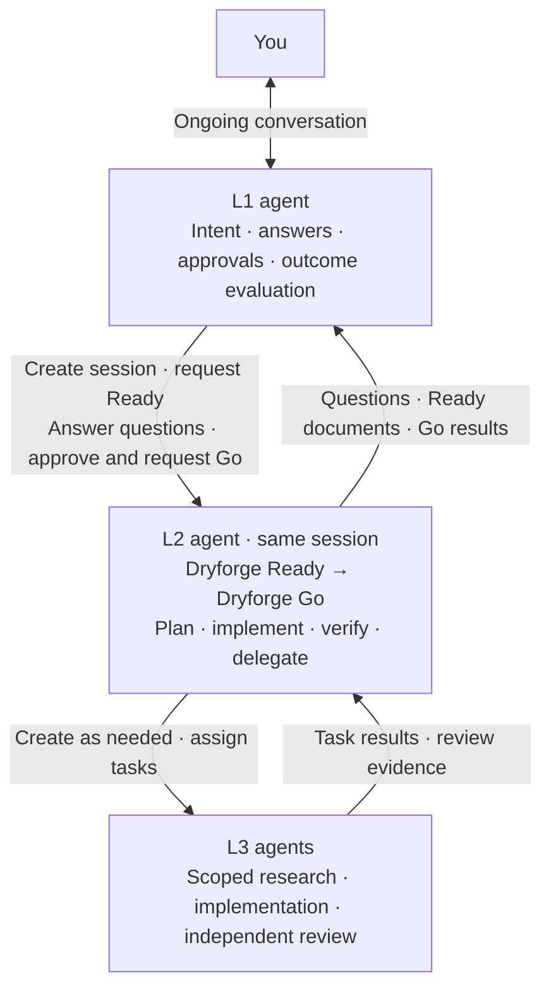

# ⟲ Ouroboros

Talk through what you want. Hand over the work when you are ready.

Ouroboros keeps an agent, **L1**, in conversation with you while it manages development. You refine the goal together, approve the proposed scope, and let L1 run and review Ready–Go cycles until the agreed outcome is met. You can keep talking to L1 while it works.

[한국어](README_ko.md) · [日本語](README_ja.md) · [中文](README_zh.md)

## Start with a conversation

| Codex | Claude Code | What happens |
| --- | --- | --- |
| `$ouroboros:init` | `/ouroboros:init` | Start talking with L1. Refine the outcome, completion criteria, constraints and decisions you want to delegate. The proposal remains editable; development cycles have not started. |
| `$ouroboros:approve` | `/ouroboros:approve` | Approve the proposal you reviewed. L1 takes responsibility for planning cycles, answering worker questions, reviewing Ready documents, running Go and checking results. |

For example, start with: “I want a local memo CLI that keeps my notes between runs. Help me work out the details.” Continue the conversation until the proposal matches your intent, then invoke `approve`.

Approval is a handoff, not the end of the conversation. L1 incorporates further clarification within the agreed scope and discusses the impact of changes that need a new decision. It handles already delegated decisions without asking you to approve each cycle or routine tool request again.

## The cycle

After the handoff, L1 invokes the installed **Dryforge Ready and Go skills**. Codex uses `$dryforge:ready` / `$dryforge:go` with native skill attachments; Claude Code uses `/dryforge:ready` / `/dryforge:go`:

1. **L1 creates an L2 agent session and requests Ready.** It supplies the cycle goal and relevant user intent. The Ready skill does not itself create the agent.
2. **L2 follows Dryforge Ready.** It investigates existing solutions and prepares the specification, plan and handoff documents. L2 asks L1 its questions; L1 answers from the user's intent and delegated authority. Decisions lacking sufficient grounding or authority return to the user.
3. **L1 reviews Ready and requests Go in the same L2 session.** It asks for revisions where needed, approves the actual documents when satisfactory, then hands Dryforge Go to the agent that retains the Ready context.
4. **L2 carries out Go implementation and verification.** It works directly or creates L3 agents for scoped assignments as the procedure requires. It gathers tests and independent review and reports the result to L1.
5. **L1 evaluates the result against the overall goal.** It requests corrections, chooses the next cycle or reports completion with evidence.

Your `ouroboros:approve` hands responsibility to L1. The later Ready approval is L1's review of a particular cycle's documents. A finished cycle is not automatically a finished goal.

For an existing codebase that needs initial project documentation, L1 can first assign **Dryforge Migration** (`dryforge:migration`) within the approved scope. L1 answers its questions, reviews the documents and independent review, and arranges the accepted checkpoint. Migration writes documentation; it does not implement product code or commit by itself. Ready–Go then starts in a fresh worker session. New or already prepared projects skip this step. [Migration operation](src/skills/init/references/orchestration.md#migration)

## Architecture



| Layer | Responsibility |
| --- | --- |
| **L1 — Your conversation partner and execution owner** | Understand and preserve your intent. Create L2, request Ready, answer questions, approve documents and request Go in the same L2 session. Evaluate results and select the next cycle. |
| **L2 — The main agent running Dryforge Ready and Go** | Carry out one cycle in the same session, including direct implementation and verification. Exchange questions and approvals with L1, manage any L3 agents and own the cycle's result. |
| **L3 — Task agents managed by L2** | Perform assigned research, implementation or review and return results to L2. Independent reviewers use a separate context from implementers. |

L2 also implements code. Under the existing Dryforge Go rules, it directly implements a single `MECHANICAL`/`NONE` task and delegates parallel or `RISKY` work to task agents. Direct implementation retains the required independent review. Keeping Ready and Go in the same session lets design context from Ready inform implementation decisions.

L1 fills the ordinary user's role for L2. L2 creates and manages its task agents; L1 does not directly manage individual L3 agents.

Ready, Go and their task agents use the ordinary caller interface. They do not need a special workflow based on whether the caller is a person or L1. Routing, delegated authority and approval records belong to the outer runtime.

Interviewing is part of L1's conversation with you. Its instructions can evolve without adding another agent or another user-facing stage. After a cycle, L1 can reuse a suitable worker session or start a fresh one with the accepted checkpoint.

## Try it

### Claude Code

Load the plugin from a checkout containing the `init` and `approve` skills:

```bash
git clone --depth 1 https://github.com/contiloop/ouroboros.git ~/ouroboros
cd /path/to/your-project
claude --plugin-dir ~/ouroboros/claude
```

Use `/ouroboros:init`, talk through the proposal, then use `/ouroboros:approve`.

### Codex

Register this checkout through Codex's local marketplace flow using `.agents/plugins/marketplace.json`, which points to `codex/plugin/`. Enable the `ouroboros` plugin, then select **`$ouroboros:init`** followed by **`$ouroboros:approve`** when the proposal is ready.

Install and enable Dryforge for the host running L2 as well. The L1 loop invokes that installed
plugin; the bundled `ouroboros:ready` / `ouroboros:go` copies are not its backend.
For external Claude workers, see the explicit plugin-loading option in [runtime setup](src/skills/init/references/runtime-bridge.md).

### Other workflows and packages

For a single cycle you supervise directly, use `ouroboros:ready` followed by `ouroboros:go`. The `migration` skill onboards an existing project into the development workflow; replacing a worker does not require it.

The repository also generates packages for Grok, Agent Plugins and Antigravity. Packaging support and live execution support are separate: the host must provide the sessions, task agents and decision relay needed for the workflow.

**Optional research tools:** Grep MCP and Context7 MCP help with public code search and library documentation. Neither is required or automatically installed. See [MCP setup](docs/RESEARCH_MCP_SETUP.md).

## Current status

Ouroboros is experimental. The implementation includes the conversation draft and approval handoff, cycle and permission checks, and an optional runtime bridge for Claude SDK and Codex App Server sessions. Automated checks cover state transitions, transport behavior and package consistency.

On Codex, live checks have confirmed discovery of the new commands and L1 handling a child approval after the parent turn ends. A complete fresh `init → approve → Ready–Go → final outcome` run is still unverified. Formal goal amendments currently commit at evaluated cycle boundaries; further conversation remains available during a cycle.

## Guides and development

- [Conversation, handoff and cycle operation](docs/MISSION.md)
- [Persistent sessions and runtime setup](src/skills/init/references/runtime-bridge.md)
- [Delegated execution scope](src/skills/init/references/runtime-bridge.md#execution-scope)

`src/skills/` is the source of truth. It contains `init`, `approve`, `ready`, `go` and `migration`. The five platform packages are generated from it using `build/build.sh`.

```bash
PYTHONDONTWRITEBYTECODE=1 python3 -m unittest discover -s ci -p 'test_*.py'
bash build/build.sh
# Commit source and generated outputs before the clean-tree reproducibility check.
python3 ci/verify.py
```

## Credits and license

Ouroboros builds on [Dryforge](https://github.com/prekuter/dryforge) by **prekuter** under [Apache-2.0](https://www.apache.org/licenses/LICENSE-2.0). Ouroboros is maintained as an independent project; its source includes code and procedures derived from Dryforge. The original [English](README.upstream.md) and [Korean](README_ko.upstream.md) READMEs are preserved for reference.

Existing `.dryforge/` state paths and internal mission identifiers are retained for compatibility. The public `mission` command has been replaced by `init` and `approve`; existing run records are not reset by that change.
