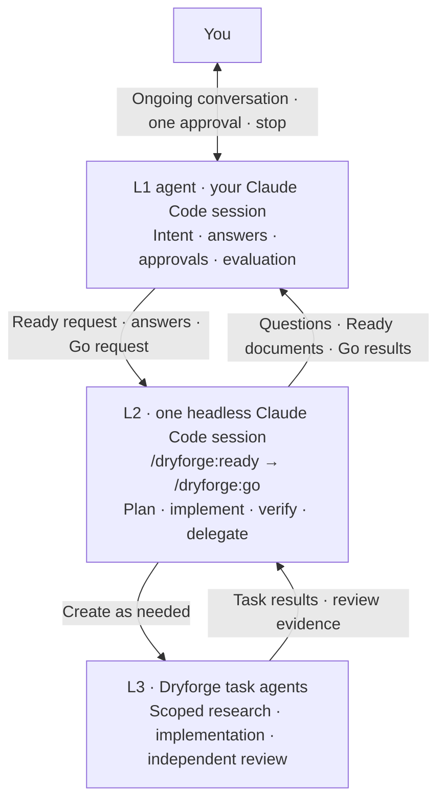

# ⟲ Ouroboros

Talk through what you want. Hand over the work once.

Ouroboros puts one agent, **L1**, in charge of a development goal inside your coding-agent session. You refine the goal together, approve the proposal once, and L1 runs Dryforge Ready–Go cycles in a persistent worker session until the goal is met. After approval L1 decides everything the goal requires; you can keep talking to it, and you can stop it at any time.

[한국어](README_ko.md) · [日本語](README_ja.md) · [中文](README_zh.md)

## Start with a conversation

| Command | What happens |
| --- | --- |
| `/ouroboros:init` | Start or continue talking with L1. Together you settle the goal, observable completion criteria, constraints, priorities, non-goals, the judgment you delegate, the workspace, and explicit limits. The proposal stays editable; no cycle runs. |
| `/ouroboros:approve` | Approve the proposal exactly as it was last shown. From here L1 owns execution and never asks for consent again. |

For example, start with: “I want a local memo CLI that keeps my notes between runs. Help me work out the details.” Continue until the proposal matches your intent, then invoke `/ouroboros:approve`.

Every proposal states its **limits**: a maximum number of cycles, a maximum number of stalled cycles, and a spend budget in USD (a number, or your explicit choice of “no cap”). `approve` refuses an incomplete proposal, and if the proposal file changed after it was shown, `approve` shows the diff and records nothing.

### After approval

Approval is a handoff, not the end of the conversation.

- **L1 decides everything the goal requires.** It answers every worker question, approves Ready documents, allows worker tool requests, merges, pushes, tags, releases and spends within the stated budget. No category of action is reserved for you during execution; L1 records its decisions as its own and never presents them as yours.
- **Clarification is folded in.** Anything within the agreed scope goes into the next message to the worker or the next cycle.
- **A scope change is a new proposal.** If the goal, completion criteria, constraints, priorities or non-goals change, L1 shows the revised proposal and you approve it again with `/ouroboros:approve`. The amendment takes effect between cycles.
- **“Stop” aborts immediately.** L1 terminates the running worker, records the run as stopped and lists what was left half-done for you to inspect. It cleans nothing up on abort.
- **Limits end the run.** When the cycle limit, the stalled-cycle limit or the budget is reached, L1 reports and stops. A revised proposal, approved again, resumes it.

Nothing executes before `approve`. Before it, L1 only reads the project and edits the draft.

## The cycle

L1 runs each cycle through the **installed Dryforge plugin**. Ouroboros ships no copy of Dryforge; if the plugin is missing or disabled, L1 reports that and starts nothing.

1. **L1 chooses one bounded outcome** from the approved intent, the previous checkpoints and the remaining completion criteria, and records the cycle start.
2. **L1 sends `/dryforge:ready` to the L2 worker session** with the cycle goal, the relevant requirements and decisions from the proposal, the project path and the checkpoint, as ordinary caller text. When L2 asks a question, L1 answers it from the proposal and its own judgment and records the basis.
3. **L1 reviews the actual Ready documents** (`handoff.md`, `spec.md`, `plan.md` in the target project, not L2's summary), sends corrections back, and on approval sends `/dryforge:go` **in the same session**.
4. **L2 implements and verifies** under Dryforge Go, directly or through the L3 task agents Dryforge creates, and reports back.
5. **L1 reviews the result**: requirement coverage, that the project's verification actually ran, independent review evidence and open issues. In-scope corrections go back to the same session. Acceptance lets L2 finish Dryforge's archive, integration and cleanup; L1 records the resulting commit as the checkpoint.
6. **L1 evaluates**: `CONTINUE`, `REPLAN`, `ESCALATE` or `COMPLETE`. `COMPLETE` requires evidence for every completion criterion. A finished cycle is not a finished goal.

The L2 session is kept across cycles by default. L1 starts a fresh session when there is none, after a `REPLAN`, when the recorded session cannot be resumed, or when its context is near the limit; every session change is recorded with its reason. On an interruption L1 inspects the workspace and documents and resumes the **same** session; uncertain writes are never replayed.

For an existing codebase without project documentation for agents, L1 can first run Dryforge Migration in a fresh session within the approved scope, then start Ready–Go in another fresh session. Migration writes documentation only. The full loop is described in [the L1 procedure](src/skills/init/references/orchestration.md).

## Architecture



| Layer | Responsibility |
| --- | --- |
| **L1 — your conversation partner and execution owner** | Runs in your session. Holds the proposal, creates and resumes L2, invokes installed Dryforge, answers questions, approves documents, accepts results, evaluates the goal, enforces the limits. |
| **L2 — the Dryforge worker** | One persistent headless Claude Code session (`claude -p`, resumed between turns) in the target project. Runs Ready and Go of one cycle in the same session. Sees only an ordinary caller; nothing in its messages mentions Ouroboros, L1, the run record or you. |
| **L3 — Dryforge's task agents** | Created and managed by L2 under Dryforge's own rules. L1 never manages L3 directly. |

**Permissions.** L2 gets the host's tools pre-allowed by list (built-in tools and MCP tools), and any further permission request is allowed automatically and recorded, so in effect L2 may use every tool except those your deny rules forbid. There is no bypass flag: your deny rules, hooks and project settings apply to L2 exactly as to a human caller. When the worker asks a structured question (as Dryforge does during Ready), the question reaches L1, which answers it from your proposal; nothing is relayed to you. Ouroboros is not a sandbox: tests, Git hooks and package scripts run with your privileges, so use it in a trusted checkout.

**Private records.** Each run lives in the target project's git-ignored `.dryforge/ouroboros/`: the proposal as shown, `run.json` (status, approvals, limits, spend, session, cycles) and an append-only `events.jsonl` with the actor of every decision (`human`, `L1`, `L2`, `host`). `init` adds `.dryforge/` to the project's `.gitignore` if it is missing. These records are never committed.

## Try it

### Claude Code

Claude Code is the supported execution host. Install and enable Dryforge, then load the plugin from a checkout:

```bash
git clone --depth 1 https://github.com/contiloop/ouroboros.git ~/ouroboros
cd /path/to/your-project
claude --plugin-dir ~/ouroboros/claude
```

Use `/ouroboros:init`, talk through the proposal, then use `/ouroboros:approve`.

### Codex

The Codex package (`codex/plugin/`, registered through `.agents/plugins/marketplace.json`) is built and installable, and `$ouroboros:init` holds the conversation. There is no Codex host adapter yet: `$ouroboros:approve` reports that and starts no run.

### Other packages

The repository also generates packages for Grok, Agent Plugins and Antigravity. They are format-only: valid to install, with no execution support.

**Optional research tools:** Grep MCP and Context7 MCP help with public code search and library documentation. Neither is required or automatically installed. See [MCP setup](docs/RESEARCH_MCP_SETUP.md).

## Current status

Ouroboros is experimental and is being rebuilt from its concept. The current implementation covers the `init` conversation, the `approve` handoff, the private run record with its limits and amendments, and the headless Claude Code worker. Automated tests cover run-record transitions, the worker command line and result parsing against a fake `claude`, skill-text contracts and package consistency; they never call a live model.

A complete unattended `init → approve → cycles → COMPLETE` run on Claude Code is **not yet live-verified**. See [docs/tracking/status.md](docs/tracking/status.md) for what is built, what is verified and what remains.

## Guides and development

- [Business rules](docs/business-rules.md) — vocabulary, lifecycle, invariants, edge cases
- [Security](docs/security.md) — trust model and authority after approval
- [Architecture](docs/architecture.md) and [operations](docs/operations.md)

`src/skills/` is the source of truth. It contains `init` and `approve` only; the five platform packages are generated from it with `build/build.sh` and never edited by hand.

```bash
TMPDIR=/private/tmp PYTHONDONTWRITEBYTECODE=1 python3 -B -m unittest discover -s ci -p 'test_*.py'
bash build/build.sh
# Commit source and generated outputs before the clean-tree reproducibility check.
python3 -B ci/verify.py
```

## Credits and license

Ouroboros builds on [Dryforge](https://github.com/prekuter/dryforge) by **prekuter** under [Apache-2.0](https://www.apache.org/licenses/LICENSE-2.0). Ouroboros is an independent project that invokes the user's installed Dryforge; it no longer ships Dryforge-derived skills. The original [English](README.upstream.md) and [Korean](README_ko.upstream.md) READMEs are preserved for reference.
