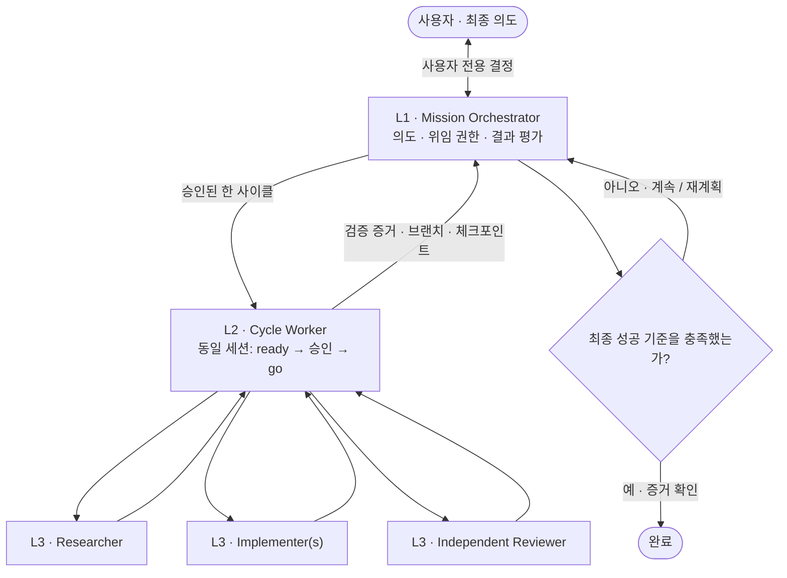

<div align="center">

# ⟲ Ouroboros

### 의도는 남기고, 개발은 순환한다.

**사용자 Intent를 중심으로 움직이는 3계층 개발 Harness**  
최종 목표부터 검증된 결과까지, 한 번에 하나의 `ready → go` 사이클.

[](#한-사이클의-규칙)
[](#3계층-아키텍처)
[](#현재-구현-범위)
[](LICENSE)

[**시작하기**](#시작하기) · [**아키텍처**](#3계층-아키텍처) · [**Mission 가이드**](docs/MISSION.md) · [**English**](README.md)

</div>

---

> [!IMPORTANT]
> **한 사이클의 성공은 최종 Mission의 완료를 뜻하지 않습니다.** Ouroboros는 사람에게서 승인받은 의도를 계속 유지하고, 실제 검증 증거에 따라 다음 사이클을 결정합니다.

> [!WARNING]
> **실험적 확장 버전입니다.** 스킬·의사결정/세션 규칙·테스트된 로컬 상태 관리 코드는 포함하지만, 선택적 [실행 연결 계층](docs/RUNTIME.md)으로 실제 Claude SDK 세션·Codex App Server thread를 유지할 수 있습니다. 의존성·전역 Hook을 자동 설치하지 않으며, 실제 3계층 실행은 아직 별도 검증이 필요합니다. 실행 환경에서 지속 세션·질문 중계·중첩 에이전트를 지원해야 합니다.

## 왜 Ouroboros인가?

한 코딩 세션이 명세대로 코드를 작성했다고 해서 사용자의 최종 목표를 달성한 것은 아닙니다. Ouroboros는 **오래 유지해야 할 의도**, **한 개발 사이클의 맥락**, **짧게 쓰는 개별 작업 맥락**을 분리합니다. 각 사이클이 끝날 때마다 최종 의도에 가까워졌는지 다시 판단합니다.

<table>
<tr><th>01 · INTENT</th><th>02 · CYCLE</th><th>03 · EXECUTION</th></tr>
<tr><td><strong>L1 · Mission Orchestrator</strong><br/>최종 의도·제약·위임 권한을 유지하고 다음 사이클을 결정합니다.</td><td><strong>L2 · Cycle Worker</strong><br/><strong>동일 세션</strong>에서 <code>ready → 승인 → go</code>를 수행한 뒤 검증 결과를 보고합니다.</td><td><strong>L3 · Task Agents</strong><br/>제한된 조사·구현·독립 검토를 수행합니다. 안전할 때만 세션을 재개합니다.</td></tr>
</table>

## 3계층 아키텍처



**판단 권한의 경계:** L1은 사람이 위임한 범위에서만 답하고 승인합니다. 목표 변경, 임의 정책 결정, 병합·배포·비용 지출·파괴적 작업·비공개 정보 공개는 필요한 승인 없이 수행하지 않습니다. L2는 자신의 다음 사이클을 독단적으로 만들지 않습니다.

## 한 사이클의 규칙

| 경계 | 원칙 |
| :-- | :-- |
| **READY → GO** | 질문 → Spec/Plan/Handoff 승인 → 구현 → 인계까지 **동일한 실제 L2 세션**. 승인은 문서 내용에 연결됩니다. |
| **L2 → L1** | 구현 범위, 실행 명령·종료 코드, 브랜치·커밋, 미해결 문제, 체크포인트를 보고합니다. |
| **다음 사이클** | L1만 Mission 결과를 평가한 뒤 **REUSE**(재개 및 컨텍스트 확인) 또는 **SPAWN**(새 세션 + 명시적 인계)을 결정합니다. |
| **L3 작업** | 같은 작업이고 계약·컨텍스트·작업 공간이 유효하면 **RESUME**. 아니면 **SPAWN + 인계**. 독립 검토는 항상 **FRESH_REVIEW**입니다. |
| **상태** | 새 Worker는 기존 결정을 자동으로 기억하지 않습니다. 승인된 코드·Harness·작업 기록을 전달받습니다. 새 세션 때문에 `migration`을 다시 실행하지 않습니다. |

### 먼저 조사하고, 그다음 구현한다

기존 **LANDSCAPE** 단계도 그대로 포함합니다. L2는 유사한 제품·프로젝트·플러그인·라이브러리를 조사하며 필요하면 읽기 전용 L3 Researcher를 생성할 수 있습니다. 이후 중요한 출처를 직접 재검토하고 사용자 의도를 확정합니다.

- **LANDSCAPE:** 기존 솔루션 **재사용 / 확장 / 신규 개발** 비교, Coverage·Evidence·Decision Stability 기준으로 검색 종료
- **ELICIT:** 중요한 요구사항과 선택을 승인받되, 검색 결과로 사용자의 의도를 대신하지 않음
- **PLAN:** 선택한 기술의 API와 실제 구현 방법 조사; `VERIFIED / UNVERIFIED / RULED_OUT` 구분
- **GO:** 핵심 기술이 불확실하면 승인된 작은 검증 실험부터 수행; 부정적 결과면 후속 구현 중단

**권장 MCP (선택 설치, Optional):** [Grep MCP](https://mcp.grep.app)는 공개 소스 검색, [Context7 MCP](https://mcp.context7.com/mcp)는 라이브러리·API 문서 확인에 사용합니다. 실행 호스트에 연결하며 **자동 설치하지 않고 필수도 아닙니다**. [MCP 설정](docs/RESEARCH_MCP_SETUP.md)을 참고하세요.

## 시작하기

<details open>
<summary><strong>Claude Code · 로컬 플러그인 테스트</strong></summary>

```bash
git clone --depth 1 https://github.com/contiloop/ouroboros.git ~/ouroboros

cd /path/to/your-project
claude --plugin-dir ~/ouroboros/claude
```

Mission은 **`/ouroboros:mission`**으로 명시적으로 실행합니다. 사람이 감독하는 단일 사이클은 `/ouroboros:ready` → `/ouroboros:go`를 사용할 수 있습니다. 실제 호스트가 필수 세션·중계·중첩 실행 기능을 제공하지 못하면 Mission 모드는 지원하는 척하지 않고 중단합니다.

</details>

<details>
<summary><strong>Codex · 로컬 플러그인 패키지</strong></summary>

`.agents/plugins/marketplace.json`이 `codex/plugin/` 패키지를 가리킵니다. 사용하는 Codex의 로컬 Marketplace 절차로 등록한 뒤 **`ouroboros`** 플러그인을 활성화하고 이전 스킬 이름이 중복되지 않는지 확인하세요. 스킬이 정상 표시되면 `$mission`, `$ready`, `$go`를 명시적으로 실행합니다.

</details>

<details>
<summary><strong>Zotero 자동화 Mission 요청 예시</strong></summary>

```text
ChatGPT와 논문을 읽다가 새로 배운 내용을 Zotero의 해당 논문에
원문과 연결된 메모·하이라이트로 저장하는 도구를 만들고 싶어.
먼저 최종 성공 기준과 위임할 결정, 실행 한도를 합의해줘.
한 번에 한 ready-go 사이클만 지속 Worker에게 할당하고,
실제 결과를 평가한 뒤 다음 사이클을 선택해줘.
목표 변경, 병합, 배포, 비용 지출은 나에게 승인받아.
```

</details>

## 현재 구현 범위

| 포함된 것 | 실행 호스트 및 실사용 검증이 필요한 것 |
| :-- | :-- |
| `mission`, `ready`, `go`, `migration` 스킬 | 실제 L1/L2 지속 세션과 L2의 L3 생성 |
| 의도·승인·세션 생명주기 계약과 선택적 확장 스킬 인터페이스 | 권한 있는 의사결정 중계와 실행 한도 강제 |
| Mission 상태 검증과 지속 Worker 연결·질문/권한 요청 중계 | 실제 모델 동작·검증 증거·중단 복원·외부 부수효과 검증 |
| LANDSCAPE 조사 규칙, 5개 플랫폼 배포본 | Claude/Codex 실제 다중 사이클 종단간 테스트 |

Hook은 **상태 관측 수단**이지 승인이 아닙니다. 프로세스 종료나 명령 성공은 Mission 완료 증거가 아닙니다. 상태 스크립트는 주어진 기록을 검증할 뿐, 실제 사람의 신원이나 테스트 결과가 진짜인지 자체적으로 판별하지 못합니다.

### 지속 Worker 연결

기본 에이전트 도구만으로 연결하기 어려우면 선택적 [실행 연결 계층](docs/RUNTIME.md)을
사용합니다. 같은 L2 세션에 후속 지시를 보내고, 질문·도구 권한 요청을 중계하며,
오래된 명세 승인은 거부합니다. 설치·인증은 사용자가 관리합니다. 모의 서버 테스트를
실제 모델의 실행 성공으로 표현하거나, 메시지 전달을 Mission 완료로 간주하지 않습니다.

### 소스 구조

```text
src/skills/
├── mission/             # L1 오케스트레이션 + 상태 기록
│   ├── SKILL.md
│   ├── references/      # 의도·사이클·호스트 계약
│   └── scripts/mission_state.py
├── ready/               # L2 의도 확정 + LANDSCAPE
├── go/                  # L2 구현 + L3 생명주기
└── migration/           # 기존 프로젝트의 최초 Harness 구성

docs/                    # Mission 및 MCP 설정 가이드
platform/                # 플랫폼별 매니페스트 입력
claude/ · codex/ · grok/ · agent-plugin/ · antigravity/
```

### 확장 스킬 연결 (선택)

L1에는 나중에 Interview·Research·Evaluation 등 다양한 스킬을 연결할 수 있습니다.
결과의 **공통 영역(상태·근거·미해결 사항)**만 표준화하고, 구체적인 내용은 각 스킬이
정의합니다. 결과가 Mission Intent의 변경을 제안하더라도 **L1 검토와 실제 사용자 승인**
없이는 반영하지 않습니다. 이 기능은 **향후 스킬을 위한 인터페이스**이지,
Interview 스킬이나 실제 에이전트 실행기가 설치됐다는 뜻은 아닙니다.
[스킬 연결 가이드](docs/SKILL_INTERFACE.md)를 참고하세요.

### 테스트 및 검증

```bash
PYTHONDONTWRITEBYTECODE=1 python3 -m unittest discover -s ci -p 'test_*.py'
bash build/build.sh
# 배포본을 커밋해 깨끗한 작업 트리를 만든 뒤 재현성 검사:
python3 ci/verify.py
```

현재 검증은 스킬 계약·로컬 상태 전이·패키지 정합성을 확인합니다. **실제 Claude Code나 Codex에서 3계층이 제대로 작동한다는 증거는 아닙니다.** 무인 실행 전 동일 세션 Ready/Go, L3 실행·독립 검토, 질문 중계, 세션 재사용·교체, 복원과 최종 목표 증거를 확인해야 합니다. 자세한 기준은 [Mission 가이드](docs/MISSION.md)에 있습니다.

---

<details>
<summary><strong>원저작자 · 호환성 · 라이선스</strong></summary>

Ouroboros는 **prekuter**의 오픈소스 프로젝트 **Dryforge**를 기반으로 한 독립 개발 Fork입니다. 원본 라이선스는 [Apache-2.0](LICENSE)이며, [원본 저장소](https://github.com/prekuter/dryforge), [영문 원본 README](README.upstream.md), [한국어 원본 README](README_ko.upstream.md)를 그대로 보존합니다. 원본의 공식 릴리스가 아닙니다.

기존 기록 디렉터리 `.dryforge/`는 이전 사이클과의 호환을 위해 유지합니다. **공개 브랜드를 바꾸더라도 사용자 기록을 조용히 이동하거나 삭제하지 않습니다.** 매니페스트 버전 `1.3.8`은 원본 버전 계열의 개발용 표기이며 Ouroboros 안정 릴리스라는 뜻은 아닙니다.

</details>
