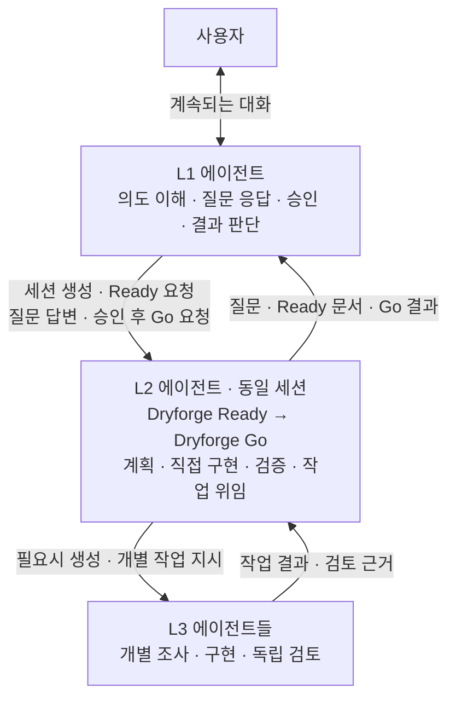

# ⟲ Ouroboros

원하는 것을 함께 구체화하고, 준비가 되면 개발을 맡기세요.

Ouroboros에서는 **L1**이 사용자와 계속 대화하면서 개발 전체를 맡습니다. 원하는 결과를 함께 다듬고 실행 범위를 승인하면, L1이 Ready–Go 사이클을 운영하고 결과를 검토하며 목표를 향해 진행합니다. 작업 중에도 L1과 계속 이야기할 수 있습니다.

[English](README.md) · [日本語](README_ja.md) · [中文](README_zh.md)

## 대화로 시작하기

| 명령 | 하는 일 |
| --- | --- |
| `/ouroboros:init` | L1과 대화를 시작합니다. 원하는 결과, 완료 기준, 제약과 위임할 판단을 함께 정리합니다. 초안은 계속 수정할 수 있으며, 아직 개발 사이클을 실행하지 않습니다. |
| `/ouroboros:approve` | 검토한 내용을 승인하고 실행을 L1에 맡깁니다. 이후 L1이 사이클 선택, 작업자의 질문 응답, Ready 문서 승인, Go 실행과 결과 검토를 담당합니다. |

예를 들어 “재실행해도 메모가 남는 로컬 메모 CLI를 만들고 싶어. 세부 내용을 같이 정리해줘”라고 시작할 수 있습니다. 대화하며 초안을 다듬고, 의도와 맞으면 `approve`로 인계합니다.

승인한 뒤에도 대화는 이어집니다. L1은 합의한 범위 안의 추가 설명을 작업에 반영하고, 새로운 판단이 필요한 변경은 영향을 설명하며 사용자와 조율합니다. 이미 위임받은 판단은 사이클이나 일상적인 도구 요청마다 다시 묻지 않고 처리합니다.

## Ready–Go 반복

실행을 인계받은 L1은 기존 **Dryforge Ready·Go 절차**를 아래 흐름으로 운영합니다. 이 플러그인에서는 `ouroboros:ready`, `ouroboros:go`라는 이름으로 제공합니다.

1. **L1이 L2 에이전트 세션을 만들고 Ready를 요청합니다.** 이번 사이클의 목표와 사용자 의도에 관한 맥락을 전달합니다. Ready 스킬 자체가 에이전트를 생성하는 것은 아닙니다.
2. **L2가 Dryforge Ready 절차를 수행합니다.** 기존 해결책을 조사하고 요구사항·계획·인계 문서를 작성합니다. 궁금한 점은 L1에 묻고, L1이 사용자 의도와 위임 범위에 따라 답합니다. 판단 근거가 부족하거나 위임 범위를 벗어나는 결정만 사용자와 조율합니다.
3. **L1이 Ready 결과를 검토하고 같은 L2에 Go를 요청합니다.** 문서가 부족하면 수정을 요청합니다. 충분하면 실제 내용을 승인한 뒤, Ready의 맥락을 가진 동일 L2 세션에 Dryforge Go를 맡깁니다.
4. **L2가 Go의 구현·검증을 진행합니다.** 절차에 따라 직접 작업하거나 필요한 L3 에이전트를 생성해 개별 작업을 맡깁니다. 테스트와 독립 검토 결과를 취합해 L1에 보고합니다.
5. **L1이 전체 목표에 비춰 결과를 평가합니다.** 보완을 요청하거나 다음 사이클을 선택하고, 목표를 충족하면 근거와 함께 완료를 보고합니다.

사용자의 `ouroboros:approve`는 L1에 실행을 맡기는 승인입니다. 이후 사이클별 Ready 승인은 L1이 실제 문서를 보고 수행합니다. 한 사이클이 끝났다는 이유만으로 전체 목표가 완료됐다고 판단하지 않습니다.

## 구조



| 계층 | 담당 업무 |
| --- | --- |
| **L1 — 사용자의 대화 상대이자 실행 책임자** | 사용자 의도를 이해하고 유지합니다. L2를 생성해 Ready를 맡기고, 질문에 답하고, 문서를 승인한 뒤 같은 L2에 Go를 맡깁니다. 결과와 다음 사이클을 판단합니다. |
| **L2 — Dryforge Ready·Go를 수행하는 메인 에이전트** | 한 세션에서 Ready부터 Go까지 수행하며 직접 코드를 구현하고 검증할 수 있습니다. L1과 질문·승인을 주고받고, 필요한 L3를 운영하며 사이클 결과를 책임집니다. |
| **L3 — L2가 사용하는 개별 작업 에이전트** | L2가 맡긴 조사·구현·검토를 수행하고 L2에 결과를 돌려줍니다. 독립 검토자는 구현자와 별개의 맥락을 사용합니다. |

구현은 L2도 담당합니다. 기존 Dryforge Go 규칙에 따라 단일 `MECHANICAL`/`NONE` 작업은 L2가 직접 구현하고, 병렬 작업이나 `RISKY` 작업은 하위 작업자에게 맡깁니다. 직접 구현할 때도 필요한 독립 검토는 유지합니다. Ready와 Go를 같은 세션에서 수행하는 것은 Ready에서 쌓은 설계 맥락을 구현 판단에 이어 쓰기 위해서입니다.

L1은 L2에 대해 기존 사용자의 역할을 합니다. L3의 생성과 작업 관리는 L2가 맡으며, L1이 개별 L3를 직접 지휘하지 않습니다.

Ready·Go와 그 아래 작업자는 일반적인 호출자 인터페이스를 사용합니다. 상대가 사람인지 L1인지에 따라 별도 절차를 적용할 필요가 없습니다. 요청 전달, 위임 범위 확인과 승인 기록은 바깥 실행 계층에서 관리합니다.

인터뷰는 사용자와 L1이 나누는 대화의 일부입니다. 향후 대화 절차를 개선해도 별도 에이전트나 사용자 단계를 추가할 필요는 없습니다. 사이클이 끝나면 L1은 상태가 적합한 작업자 세션을 재사용하거나, 검증된 결과를 새 작업자에게 인계합니다.

## 설치와 실행

### Claude Code

`init`과 `approve` 스킬이 포함된 체크아웃에서 플러그인을 불러옵니다.

```bash
git clone --depth 1 https://github.com/contiloop/ouroboros.git ~/ouroboros
cd /path/to/your-project
claude --plugin-dir ~/ouroboros/claude
```

`/ouroboros:init`으로 대화한 뒤, 정리한 내용을 검토하고 `/ouroboros:approve`를 실행합니다.

### Codex

`.agents/plugins/marketplace.json`을 사용하는 로컬 마켓플레이스 절차로 이 체크아웃을 등록합니다. 이 파일은 `codex/plugin/` 패키지를 가리킵니다. `ouroboros` 플러그인을 활성화한 뒤 **`$ouroboros:init`**을 선택하고, 초안을 검토한 후 **`$ouroboros:approve`**를 선택합니다.

### 다른 실행 방식과 패키지

사용자가 직접 감독하는 단일 사이클은 `ouroboros:ready` → `ouroboros:go`로 실행할 수 있습니다. `migration`은 기존 프로젝트에 개발 작업 구조를 구성하는 스킬이며, 작업자를 교체할 때마다 실행하지 않습니다.

Grok, Agent Plugins, Antigravity용 패키지도 생성합니다. 패키지 제공 여부와 실제 실행 지원은 구분해야 합니다. 실행 호스트가 필요한 지속 세션, 하위 에이전트와 의사결정 중계를 제공해야 합니다.

**선택적 조사 도구(Optional):** Grep MCP는 공개 코드 검색, Context7 MCP는 라이브러리 문서 확인에 사용할 수 있습니다. 필수 도구가 아니며 자동 설치하지 않습니다. [MCP 설정](docs/RESEARCH_MCP_SETUP.md)을 참고하세요.

## 현재 상태

Ouroboros는 실험 단계입니다. 대화 초안과 실행 인계, 사이클·권한 검증, Claude SDK와 Codex App Server 세션을 연결하는 선택적 실행 계층이 구현돼 있습니다. 자동 검사는 상태 전이, 요청 전달과 패키지 정합성을 확인합니다.

Codex에서는 새 명령의 인식과 부모 턴 종료 후 자식의 승인 요청을 L1이 처리하는 흐름을 실제로 확인했습니다. 새 세션에서 `init → approve → Ready–Go → 최종 목표 달성`까지 완주하는 검증은 아직 남아 있습니다. 현재 정식 목표 변경은 평가가 끝난 사이클 경계에서 반영하며, 사이클 도중에도 대화는 계속할 수 있습니다.

## 상세 문서와 개발

- [대화, 실행 인계와 사이클 운영](docs/MISSION.md)
- [지속 세션과 실행 환경 설정](docs/RUNTIME.md)
- [실행 권한 위임 범위](src/skills/init/references/runtime-permissions.md)
- [L1의 의도 이해와 판단 입력 확장](docs/SKILL_INTERFACE.md)

원본은 `src/skills/`에 있습니다. `init`, `approve`, `ready`, `go`, `migration`을 포함하며, `build/build.sh`가 다섯 플랫폼용 패키지를 생성합니다.

```bash
PYTHONDONTWRITEBYTECODE=1 python3 -m unittest discover -s ci -p 'test_*.py'
bash build/build.sh
# 소스와 생성된 패키지를 커밋한 뒤 깨끗한 작업 트리에서 재현성을 검사합니다.
python3 ci/verify.py
```

## 원저작자와 라이선스

Ouroboros는 **prekuter**의 [Dryforge](https://github.com/prekuter/dryforge)를 기반으로 한 독립 Fork이며 [Apache-2.0](LICENSE)을 따릅니다. 원본 [영문](README.upstream.md)과 [한국어](README_ko.upstream.md) README는 참고용으로 보존합니다.

기존 `.dryforge/` 기록 경로와 내부 mission 식별자는 호환성을 위해 유지합니다. 공개 `mission` 명령은 `init`과 `approve`로 바뀌었으며, 이 변경으로 기존 실행 기록을 초기화하지 않습니다.
